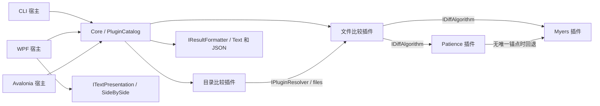

# ModularDiff

插件式的文件 / 目录比较工具，提供跨平台 CLI、Windows WPF GUI 和基于 Avalonia 的跨平台 GUI（Windows / macOS / Linux）。
比较算法、比较模块、输出格式以及编辑、同步、备份能力均以插件形式动态加载——新增任意一种能力都不需要修改或重新编译宿主程序。

## 功能特性

- **文件与目录比较**：左右逐行对齐显示差异；目录视图呈现名称、大小、修改时间与状态，支持全部 / 差异 / 相同 / 仅左 / 仅右筛选和路径搜索。
- **可插拔算法**：内置 Myers（最短编辑脚本）与 Patience（可读对齐）两种算法，可加载自行开发的算法插件。
- **精细文本展示**：行内变化区着色、轻量语法高亮、差异块导航（F7 / Shift+F7）、概览条点击定位、仅差异 / 带上下文视图、双侧同步滚动、行内搜索（Ctrl+F）、多窗口错开排列（Ctrl+N）。
- **编码与二进制**：支持 UTF-8（有无 BOM 均可）、带 BOM 的 UTF-16 / UTF-32；二进制与超大文件自动切换为流式字节比较。
- **编辑与合并**：左右两侧均可编辑，支持块级双向复制、每侧独立的撤销 / 重做、保存前 SHA-256 冲突检测，外部修改不会被告警前覆盖。
- **重对齐与行工具**：编辑后可按当前算法与忽略选项立即重算对齐（⟳ 手动 / ⚡ 自动，不重读磁盘、保留未保存修改）；右键行按领域规则换行（如 CSS 多属性行拆成每属性一行，支持选区批量），⌗ 按语言格式化整侧文档（如 css-format）；行尾风格全程沿用原文件。
- **目录同步**：带预览的批量复制、覆盖前自动备份、持久化操作记录与历史恢复，支持双向补齐和逐项冲突决策。
- **插件隔离加载**：每个插件包使用独立的 AssemblyLoadContext 与依赖解析，宿主只依赖契约程序集。
- **命名会话与最近比较**：左右路径 + 算法 + 忽略规则一键保存为命名会话，随时重开；最近比较自动记录（去重、上限 10 条），WPF 与跨平台版共用同一存储。
- **不重要差异规则**：正则把匹配文本（如 `$Id$`、版本号、时间戳）标记为不重要，不产生差异块——配置与代码评审利器（CLI `--unimportant`，GUI 规则框每行一条）。
- **十六进制比较**：二进制文件并排 hex dump，差异字节红色高亮、共享偏移列、自动定位首个差异，虚拟化渲染支持大文件。
- **图片比较**：PNG / JPEG / BMP / GIF 并排显示，尺寸一致时右侧叠加半透明红色差异像素；尺寸与差异段直接从文件头解析，无图像库依赖。
- **HTML 报告**：`--format html` 输出自包含着色并排报告，适合存档与分享（CLI 与 GUI 导出均可用）。
- **资源管理器集成**（Windows，可选）：`ModularDiff Compare / Select Left / Compare to '<名称>'` 系列右键命令，随选中数量与记忆的左侧动态出现（与 Beyond Compare 同类的原生 COM 菜单扩展）。

## 系统要求

- [.NET 10 SDK](https://dotnet.microsoft.com/download/dotnet/10.0)
- **WPF GUI**：Windows（`ModularDiff.sln`）
- **跨平台 GUI**：Avalonia 11，支持 Windows / macOS / Linux（`ModularDiff.CrossPlatform.sln`）
- **CLI**：全部平台

## 快速开始

Windows（PowerShell）：

```powershell
./build.ps1      # 构建插件、CLI、GUI 并运行测试
./run-gui.ps1    # 打开 WPF 图形界面（或双击 ModularDiff.GUI.cmd）
./demo-gui.ps1   # 直接打开内置示例目录对比
```

macOS / Linux：

```bash
dotnet build ModularDiff.CrossPlatform.sln -c Release
# 或使用发布脚本生成自包含应用（使用者无需安装 .NET）：
cd cross-platform
bash build.sh osx-arm64    # Apple Silicon；可选 osx-x64 / linux-x64 / linux-arm64 / win-x64
```

CLI 用法：

```powershell
./run-cli.ps1 plugins                                                        # 列出实际加载的插件
./run-cli.ps1 compare ./samples/left/Calculator.cs ./samples/right/Calculator.cs
./run-cli.ps1 compare ./samples/left ./samples/right --algorithm patience
./run-cli.ps1 compare ./samples/left ./samples/right --format json --output ./report.json
```

CLI 退出码：`0` 相同、`1` 有差异、`2` 错误或比较不完整、`130` 取消；发现差异返回 `1` 是正常行为，便于脚本集成。`--output` 要求新文件，避免无提示覆盖已有报告。

常用选项：`--module files|directories|pictures`、`--plugins PATH`、`--algorithm ID`、`--format ID`、`--ignore-case`、`--ignore-whitespace`、`--ignore-eol`、`--unimportant REGEX`（可重复，标记不重要文本）、`--no-recursive`、`--max-text-mb N`。算法、模块、输出格式参数均为插件 ID，不是写死的枚举；两个图片文件会自动选择 pictures 模块。

## 项目结构

```text
shared/                           两个 GUI 共用的实现
  ModularDiff.Contracts/          插件契约与 UI 无关模型
  ModularDiff.Core/               插件加载、依赖校验、比较调度
  ModularDiff.Cli/                跨平台命令行宿主
  plugins/                        算法、比较、编辑、合并、同步、备份、格式化、行拆分与展示插件
windows/
  ModularDiff.Gui/                WPF 界面、Windows 对话框、右键菜单注册
  ModularDiff.ShellExt/           Explorer 右键菜单 COM 扩展（NativeAOT 原生 DLL）
cross-platform/
  ModularDiff.Desktop/            Avalonia 界面与编辑会话
  ModularDiff.Desktop.Tests/      Headless 界面与集成测试
  build.ps1 / build.sh            跨平台构建、发布与 macOS 打包
examples/                         可独立加载的插件示例
samples/                          比较示例数据
tests/ModularDiff.Tests/          核心与插件测试
ModularDiff.sln                   全部项目（含 WPF，Windows 上构建）
ModularDiff.CrossPlatform.sln     共享项目 + Avalonia + 测试（任意平台）
```

三个宿主（CLI、WPF、Avalonia）只引用 Core / Contracts，不引用任何内置插件程序集；GUI 下拉框中的算法、模块、格式列表全部来自插件目录。跨平台构建不需要 Windows Desktop SDK。



## 插件系统

每个插件包是一个目录，包含 `plugin.json` 清单、主 DLL 及私有依赖：

```json
{ "apiVersion": 1, "assembly": "Your.Plugin.dll" }
```

可实现的契约接口：

| 接口 | 职责 |
|---|---|
| `IDiffAlgorithm` | 接收两个行键序列，返回 Equal / Delete / Insert 编辑脚本 |
| `IComparisonModule` | 判断支持的输入、异步比较、进度与取消 |
| `IResultFormatter` | 将统一结果写入 `TextWriter`，用于 CLI 与 GUI 导出 |
| `ITextPresentation` | 将行编辑脚本转换为成对行、差异块与折叠视图模型 |
| `ILineSplitter` | 差异对齐页右键"换行"：按领域规则把一行拆成多行（如 CSS 多属性行），支持选区批量 |
| `ICodeFormatter` | 把整侧文本按语言规范重排（选择器 / 声明 / 缩进等），⌗ 按钮调用 |
| `IEditBufferFactory` / `ITextStorage` / `IBufferComparison` / `IBlockMerge` | 编辑缓冲、磁盘读写与冲突检测、缓冲比较、块合并 |
| `ISyncPlanner` / `ISyncExecutor` / `ISyncBackup` / `ISyncJournal` / `ISyncRecovery` | 同步计划、执行、备份、记录与恢复 |

加载器为每个包创建独立的 `AssemblyLoadContext`，用 `AssemblyDependencyResolver` 解析私有依赖，并强制复用宿主的 Contracts 程序集。包内所有公开、非抽象、实现 `IPlugin` 的类需要公共无参构造函数；实例在宿主存活期间复用，算法与比较插件必须可并发调用。重复 ID、API 不匹配、缺失依赖、依赖环都会在启动时报告诊断；存在加载诊断时宿主不会静默降级。插件是宿主进程内执行的受信任代码，加载上下文用于依赖隔离，不是安全沙箱。

### 编写自己的算法

`examples/ModularDiff.Algorithms.Position` 是一个只引用 Contracts 的完整示例：

```powershell
dotnet build ./examples/ModularDiff.Algorithms.Position -c Release -o ./artifacts/plugins/Position
./run-cli.ps1 compare ./samples/left/Calculator.cs ./samples/right/Calculator.cs --algorithm position
```

无需重新编译 CLI / GUI，重启 GUI 即可在算法下拉框中看到新算法。新增比较模块（`IComparisonModule`）与输出格式（`IResultFormatter`）的打包方式相同。

## 算法与比较语义

- **Myers**：按编辑距离展开前沿并回溯，产生最短插入 / 删除脚本；超大输入触发预算保护时在结果中标记 `IsApproximate`，仍完整表示两侧内容。
- **Patience**：以两侧唯一行的最长递增子序列为锚点递归对齐，侧重可读性；无锚点时回退到 Myers。
- 默认区分大小写、行内空白与 CRLF / LF / CR；`--ignore-whitespace` 删除行内所有 Unicode 空白但不删除空行。
- 文本编码与 BOM 差异不计为文本差异；含 NUL 或无法按支持编码解码的文件使用精确字节比较。
- 超过阈值（默认每侧 8 MiB，可调）的文件使用流式字节比较；目录比较只比较文件集合与内容，不遍历符号链接 / junction，遇到时在结果中报告错误。

## 编辑与同步

- **编辑**：编辑保留在内存中，保存前不改动磁盘；切换文件或退出时提供保存 / 放弃 / 取消选择。保存采用 SHA-256 乐观冲突检测与临时文件替换，磁盘文件被外部修改时拒绝覆盖。二进制与超大输入保持只读。
- **同步**：所有复制入口先打开预览（方向、大小、时间、汇总），可逐项修改方向或跳过；执行时逐文件校验指纹、覆盖前备份、原子化记录操作历史，支持从历史恢复。双向模式默认补齐两侧独有文件，同名不同内容的文件标记为冲突并跳过，由用户手动决策。同步按原始字节处理，不受文本比较忽略规则影响。
- **备份与记录**：默认保存在系统 `LocalApplicationData/ModularDiff/SyncHistory`，可通过 `--sync-history-root PATH` 指定；备份损坏或缺失时拒绝覆盖目标。

## 资源管理器右键比较（Windows）

安装后（GUI 齿轮面板或 `--shell-install`）右键菜单出现 `ModularDiff …` 系列命令，由一个 NativeAOT 原生 COM 菜单扩展（`ModularDiff.ShellExt.dll`，与 Beyond Compare / TortoiseGit 的 shellex 同类，无 .NET runtime 依赖）按当前选择动态生成，前置分隔线独立成组：

- **同时选中两个文件 / 目录**：仅显示 `ModularDiff Compare`，一键比较这两项（不同后缀、不同编码均可——按内容自动选择文本或二进制比较方式）。
- **选中单项（未记忆左侧）**：仅显示 `ModularDiff Select Left`。
- **选中单项（已记忆左侧）**：显示 `ModularDiff Compare to '<左侧名称>'` 与 `ModularDiff Select Left`；前者直接与记忆的左侧比较，后者重设左侧。
- 混合文件 / 目录、多于两项或重复路径时不显示任何命令。

左侧路径由 `Select Left` 记忆并持久保存，路径失效时自动忽略。注册在 HKCU 下，无需管理员权限；移动程序目录后重新安装即可。更新扩展 DLL 后需重启资源管理器（任务管理器 → 重新启动 Windows 资源管理器）才会加载新版本。

## 跨平台版本

独立的 Avalonia GUI 位于 [`cross-platform`](cross-platform/README.md)，与 WPF 版共享核心、CLI 和全部插件；支持 Windows / macOS / Linux 的构建、发布与 macOS 应用包。当前功能范围与构建细节见 [cross-platform/README.md](cross-platform/README.md)。
